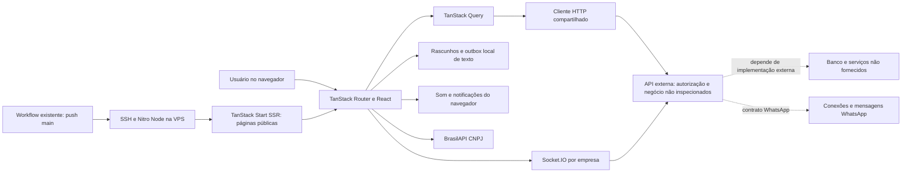

# Arquitetura e integrações

Nenhum fluxo remoto foi executado. Setas tracejadas são dependências externas, não comprovação de serviços instalados.

---

[Voltar ao sumário](../README.md) · Documentação 1.0.0 · 18/10/2026
