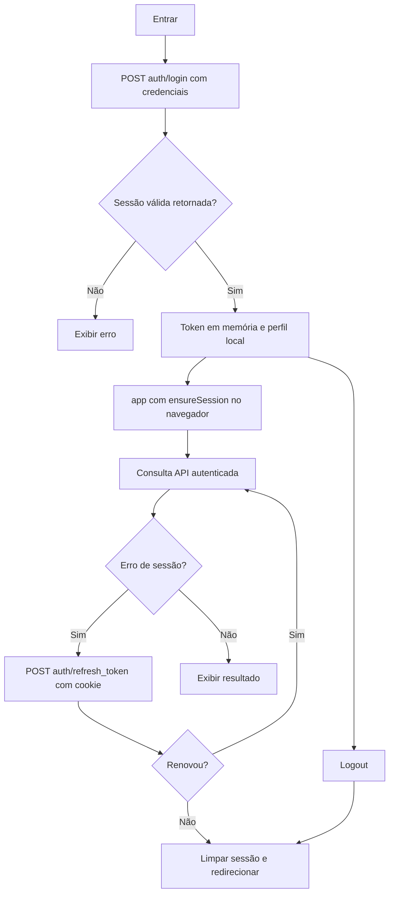
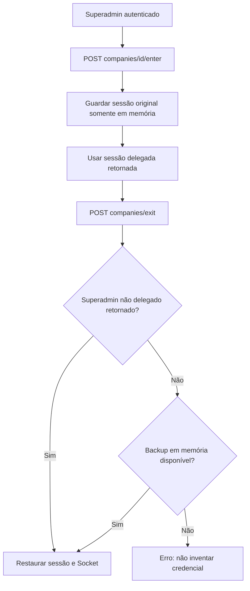

# Autenticação

A repetição após refresh é limitada; atributos do cookie dependem do servidor.

Fallback local não comprova conclusão remota da saída.

---
[Voltar ao sumário](../README.md) · Documentação 1.0.0 · 18/10/2026
