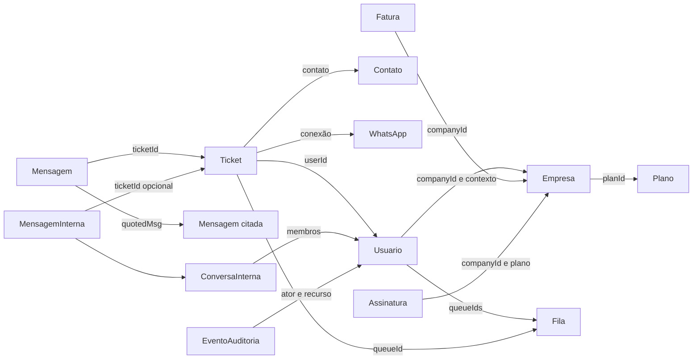

# Relacionamentos lógicos — não schema físico

O banco real não foi fornecido. Este diagrama relaciona conceitos e campos consumidos pelo frontend; não afirma nome de tabela, foreign key, cardinalidade, RLS ou índice.

Consultar [limites e evidências necessárias](../banco-de-dados.md). Não preencher um ERD físico fictício para suprir a ausência do backend.

---

[Voltar ao sumário](../README.md) · Documentação 1.0.0 · 18/10/2026
