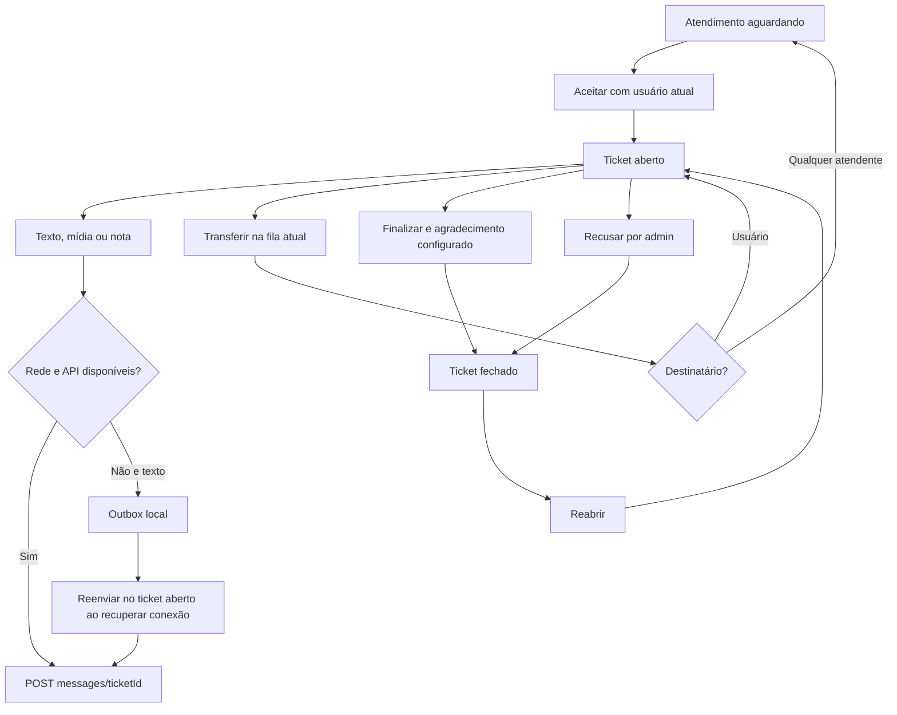
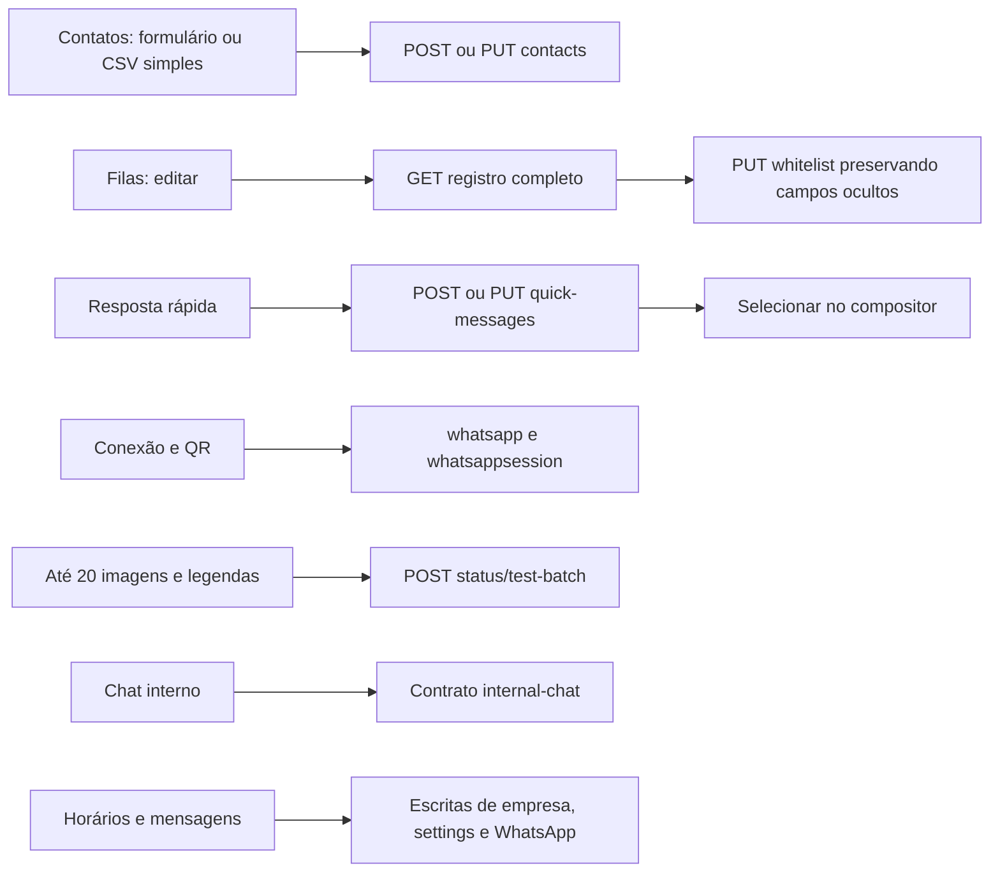

# Operação dos módulos

Recusa também oculta localmente; não é transferência. Anexos não vão à outbox.

Sucesso de chamada não comprova publicação individual de Status ou execução de automação fora do expediente.

---
[Voltar ao sumário](../README.md) · Documentação 1.0.0 · 18/10/2026
