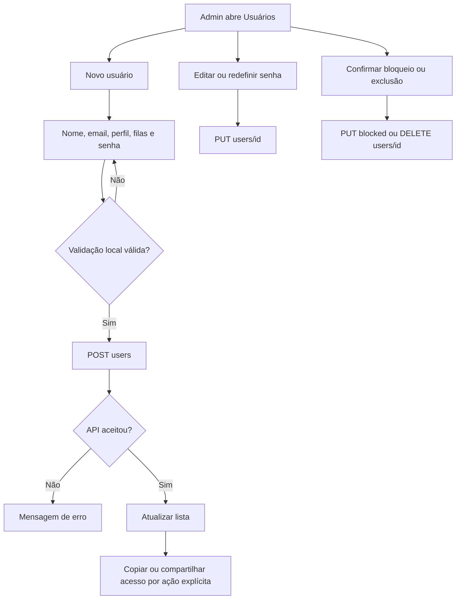

# Cadastro e gestão de usuários

Bloqueio/revogação e isolamento são responsabilidades backend não comprovadas. Perfil supervisor não é role interna independente. Senhas reais nunca integram este documento.

---
[Voltar ao sumário](../README.md) · Documentação 1.0.0 · 18/10/2026
