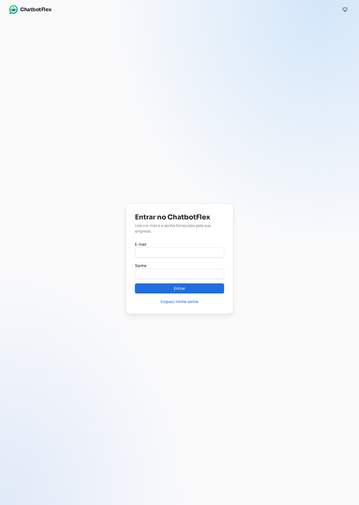
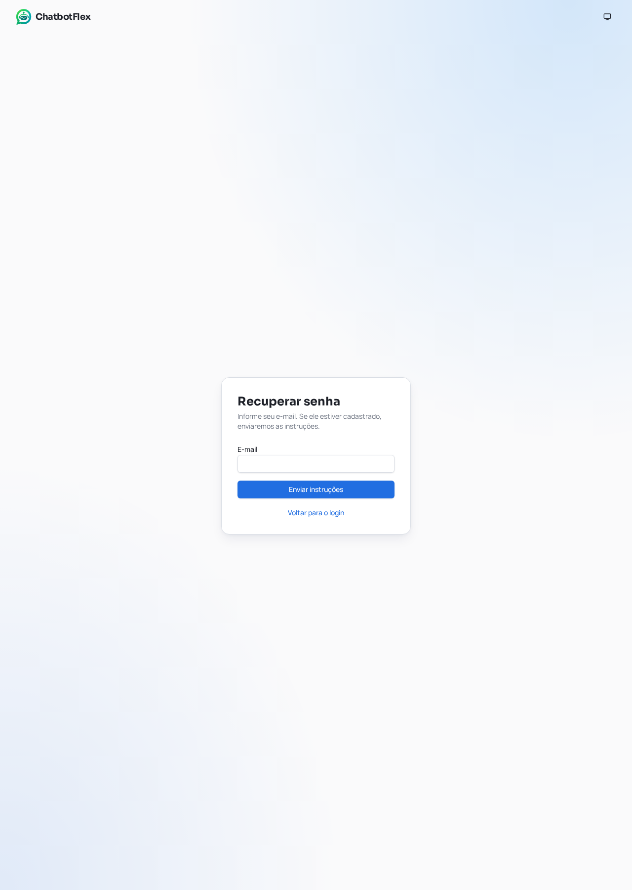

# 2. Entrar e recuperar senha

## 2.1 Entrar

**Objetivo:** acessar sua empresa. **Quem:** usuário cadastrado. **Acesso:** `/login` ou botão Entrar da página inicial.

1. Preencha E-mail com o endereço cadastrado (até 255 caracteres).
2. Preencha Senha; o login exige valor não vazio, até 128 caracteres.
3. Clique Entrar e aguarde. A sessão é validada pelo servidor.
4. O sistema pode voltar à página protegida solicitada ou à área `/app`.

**Resultado:** área autenticada. **Erros:** dados incorretos → conferir e-mail/senha; serviço indisponível → tentar mais tarde sem insistir repetidamente; acesso negado → contatar administrador. Empresa bloqueada/vencida pode impedir operação mesmo após login.

_Campos: E-mail e Senha; ação principal: Entrar; link: Esqueci minha senha. Captura local sem credenciais em 18/10/2026._

## 2.2 Recuperar senha

**Quem:** pessoa com e-mail cadastrado. **Acesso:** Esqueci minha senha.

1. Informe E-mail.
2. Clique Enviar instruções.
3. Confira a mensagem exibida e sua caixa de entrada, inclusive spam.
4. Use o link de recuperação recebido; não compartilhe o token do link.

O texto evita revelar se o e-mail está cadastrado. Entrega real de e-mail não foi testada; se não chegar, peça ao administrador verificar o serviço.

## 2.3 Redefinir

**Acesso:** link com token, em `/redefinir-senha`. Informe nova senha entre 8 e 128 caracteres e repita na confirmação. Valores devem coincidir. Envie e siga o resultado da tela. Token ausente, inválido ou vencido exige nova solicitação; aceitação depende do backend.

## 2.4 Sair

Abra seu menu de perfil, selecione Sair e confirme. A aplicação limpa a sessão e tenta encerrar no servidor. Sair da empresa delegada é diferente de sair da conta: superadmin usa o botão de retorno à plataforma.

**Fonte:** `src/modules/auth/pages/*`, `schemas/auth-schemas.ts`, `src/shared/auth/auth-service.ts`, `src/app/layout/AppShell.tsx`.

---

[Voltar ao sumário](../../README.md) · Documentação 1.0.0 · 18/10/2026
